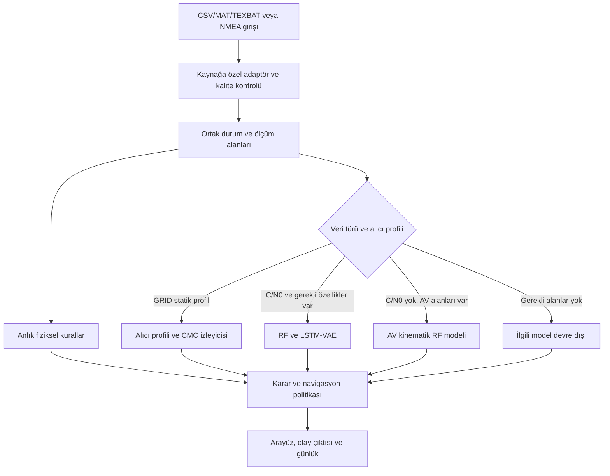

# GNSS ölçüm tutarlılığı prototipi: yazılım mimarisi

Bu belge uygulamanın gerçek yazılım akışını özetler. Uygulama GNSS alıcısı içinde çalışmaz; RF örneklerini demodüle etmez ve uçuş kontrolüne komut göndermez.

## Veri ve karar akışı

Dosya oynatımı, NMEA canlı girişi ve bazı opsiyonel IMU girişleri desteklenir. Her adaptör birim ve alan sözleşmesine göre veriyi ortak şemaya dönüştürür; eksik özellikler uygun modeli devre dışı bırakabilir. Ham IQ/BIN için önce GNSS yazılım alıcısı gerekir.

## Tespit bileşenleri

- `detection.py` fiziksel/kinematik kuralları ve varsa alıcı durum göstergelerini değerlendirir. Bağımsız navigasyon çerçevesinde IMU/yönelim yoksa bu tutarlılık yolu kullanılamaz.
- `ml_detection.py` veri yeterliyse RF sınıflandırıcısı ve LSTM-VAE anomali skorunu çalıştırır; özellik yoksa uygun katmanı kapatır. Model skorları kalibre edilmiş saldırı olasılığı değildir.
- Alarm kararları fiziksel kural, sınıflandırıcı doğrulaması veya VAE eşik+süreklilik koşulundan ayrı ayrı gelir. Ölçekleri ortak kalibre edilmediğinden RF/VAE skorları ağırlıklı toplamla olasılık gibi birleştirilmez; arayüz kalibre edilmiş güven yüzdesi göstermez.
- Statik TEXBAT GRID profili için alıcı profili ve `code_carrier.py` CMC gözlemleri kullanılır. CMC tek başına spoofing doğrulaması değildir ve alıcı/kayıt özelinde eşiklenmiştir.
- `navigation.py` şüpheli GNSS ölçümlerini kabul etmeme, filtreleme ve varsa bağımsız IMU ile inertial prediction davranışını yönetir. Bu bir uçuşa elverişlilik veya gerçek INS donanım testi iddiası değildir.
- `forensic_ledger.py` olay günlüğü bütünlüğü için HMAC zinciri sağlar. HMAC zinciri veri kaynağını, saldırı sınıfını veya geçmişin harici olarak korunmasını tek başına ispatlamaz.

## İlgili modüller

`main.py` içindeki `run_app()` Streamlit başlangıç noktasını ve arayüz döngüsünü kurar; modül içe aktarıldığında uygulama başlatılmaz. `simulation.py` tek gözlemin algılama, navigasyon ve metrik hesabını UI çizmeden yürütür. `ui.py` kenar çubuğu, başlık ve durum mesajlarından oluşan uygulama kabuğunu çizer. `dataset_adapters.py`, `dataset_loader.py`, `nmea_stream.py` ve `live_gps.py` veri girişini; `detection.py`, `ml_detection.py`, `receiver_profile.py` ve `code_carrier.py` tespit yollarını; `fusion.py` ve `navigation.py` kestirim/kabul akışını koordine eder. Doğrulama kapsamı için [PROJE_RAPORU.md](PROJE_RAPORU.md), gerçek veri ve bilinen sınırlamalar için [DATA_PROVENANCE.md](DATA_PROVENANCE.md) ile [ACTIVE_ISSUES.md](ACTIVE_ISSUES.md) esas alınmalıdır.
