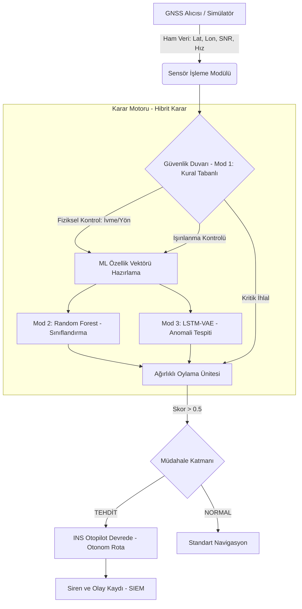
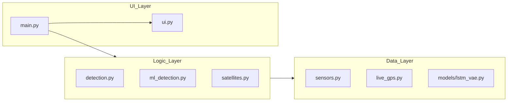

# PROJE TEKNİK MİMARİSİ VE VERİ AKIŞI 🛰️🛡️

Bu doküman, "GNSS Sinyal Bütünlüğü için Hibrit Yapay Zeka Destekli Otonom Müdahale Sistemi"nin iç işleyişini ve modüler yapısını görselleştirmek için hazırlanmıştır.

## 1. Veri Akış Diyagramı (Data Flow)

Aşağıdaki şema, ham GPS verisinin sisteme girişinden itibaren nasıl işlendiğini ve otonom müdahalenin nasıl tetiklendiğini gösterir:

## 2. Modüler Mimari Yapısı

Projenin dosya yapısı ve modüller arası bağımlılıklar:

## 3. Özgün Teknolojiler ve Yenilikler
1.  **Dinamik Eşikleme:** Hıza duyarlı ivme analizi.
2.  **Zero-Day Koruma:** LSTM-VAE ile imzasız saldırı tespiti.
3.  **Hibrit Oylama:** Üç farklı karar vericinin (Kural, RF, VAE) sonuçları ağırlıklandırması.
