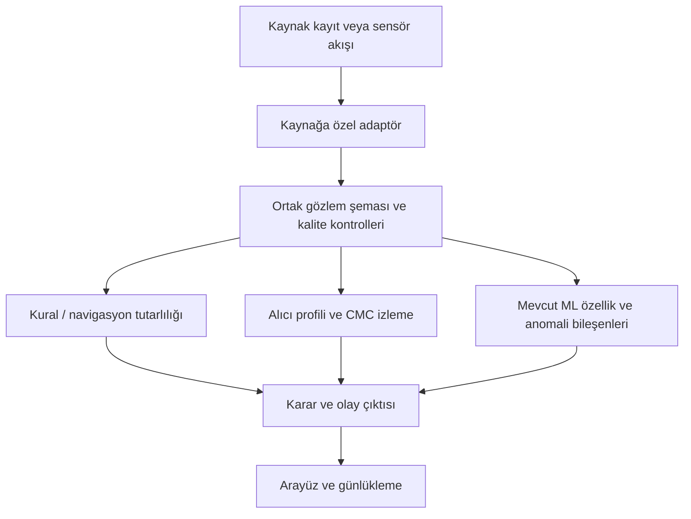

> Güncellik notu (23 Ekim 2026): Bu rapor, ölçülmüş sonuçları ve sınırlamaları ayıracak şekilde yenilenmiştir. TEXBAT sonuçlarının ayrıntısı [güncel replay raporunda](TEXBAT_CURRENT_VALIDATION.md), diğer veri kümeleri ve açık sorunlar [doğrulama raporlarında](ACTIVE_ISSUES.md) yer alır. Sonuçlar araştırma prototipine aittir; bağımsız alıcı/saha başarısı olarak yorumlanmamalıdır.

# TEKNİK RAPOR: GNSS Ölçüm Tutarlılığı ve Anomali İzleme Yazılım Prototipi

## 1. ÖZET (ABSTRACT)
Bu çalışma, GNSS ölçüm akışlarında tutarsızlıkları izleyen kural tabanlı, istatistiksel ve makine öğrenmesi bileşenlerinden oluşan bir araştırma prototipini sunar. Sistem, giriş adaptörleri üzerinden farklı kayıt biçimlerini ortak bir ölçüm modeline dönüştürür. Güncel TEXBAT değerlendirmesi yayımlanmış GRID NAV/kanal ölçümlerine dayalıdır; ham RF IQ sinyalleri bu replay'de yeniden alıcıdan geçirilmemiştir. DS7'de ilk yeni alarm enjeksiyon başlangıcından 5,60 s sonra oluşmuş, 1.789 saldırı örneğinin 27'si bu alarmdan önce kalmıştır. Farklı alıcıdan 209 nominal CMU uçuşu [yayımlanmış veri kümesiyle](https://doi.org/10.1038/s41597-021-00930-x) önceki dondurulmuş sürümde bağımsız sınanmış ve nominal varsayım altında %48,98 örnek alarm oranı vermiştir; sonraki düzeltmeler aynı kayıtlarda geliştirildiğinden güncel sürüm için bağımsız holdout yoktur. Veri saldırı etiketi taşımadığından bu oran kesin FAR değildir. Sistem sonuçları saldırı türünü tek başına doğrulamaz; INS sürekliliği de fiziksel sensörle doğrulanmış saha performansı anlamına gelmez.

---

## 2. GİRİŞ VE LİTERATÜR
GNSS spoofing tespiti; alıcı içi sinyal özellikleri, kod/taşıyıcı ölçümleri, navigasyon çözümü tutarlılığı ve anten/yön bilgisi gibi farklı kanıt türlerini kullanır. Her ölçütün farklı saldırı ve alıcı koşullarındaki duyarlılığı değişir; tek bir ölçüt bütün saldırıları kapsamaz. Literatürde ölçüt birleştirme yöntemleri, eşiklerin alıcıya uygun nominal veride kalibre edilmesini ve yanlış alarm olasılığının açıkça değerlendirilmesini vurgular [1, 2]. Bu çalışma, mevcut alıcı çıktıları üzerinde kural, CMC ve öğrenilmiş skorları inceleyen bir prototiptir; ham IQ korelatör ölçümleri veya dizi anten yön bilgisi kullanan yöntemlerle eşdeğer değildir. Bu nedenle “zero-day koruması” veya tüm saldırılara karşı bütüncül savunma iddiasında bulunulmamaktadır.

---

## 3. LİTERATÜR KARŞILAŞTIRMA (COMPARATIVE ANALYSIS)

Aşağıdaki tablo yöntem ailelerini ve bu projedeki kanıt sınırını özetler; doğrudan performans kıyaslaması değildir:

| Yaklaşım | Gözlenen kanıt | Güçlü olduğu koşul | Sınırlama | Bu projedeki karşılığı |
| :--- | :--- | :--- | :--- | :--- |
| Sinyal gücü / C/N0 ve korelatör kalite ölçütleri [1, 6, 7] | Alıcı izleme kanalı veya IQ/korelatör çıktıları | Sinyal gücü ve korelasyon yapısı değiştiğinde | Bazı yumuşak/güç eşleşmeli saldırılar için tek başına yetersiz olabilir; belirli kanallar gerekir | Ham IQ/korelatör SQM şu anki TEXBAT replay'inde yok |
| Kod-taşıyıcı ve ölçüm artıkları [1, 2, 3] | Pseudorange, taşıyıcı fazı ve alıcı ölçümleri | Ölçüm tutarsızlığı oluştuğunda | Multipath, iyonosfer, gürültü ve alıcı sapmaları da etkiler | CMC eğimleri yardımcı tutarsızlık göstergesi olarak inceleniyor |
| Kinematik / GNSS-INS tutarlılığı [1] | GNSS ile bağımsız IMU/yönelim/konum | Hareket ölçümleri bağımsız ve zaman eşlemesi güvenilir olduğunda | Sensör kalibrasyonu ve hizalama gerekir; alıcı NAV tek başına bağımsız referans değildir | Bağımsız IMU ile saldırı doğrulaması henüz tamamlanmadı |
| Çoklu ölçüt istatistiksel birleştirme [2] | Alıcıya özgü kalibre edilmiş ölçütler | Nominal dağılımlar ve yanlış alarm hedefi bilindiğinde | Kalibrasyon ve ayrı test verisi gerektirir | Mevcut karar mantığı araştırma prototipi; olasılıksal FAR garantisi yok |

---

## 4. YÖNTEM VE UYGULAMA KATKISI
Projenin teknik katkısı, farklı veri kaynaklarını ortak şemaya alan adaptörler ile ölçüm kurallarını, alıcı profillerini, CMC tabanlı izlemeyi ve mevcut öğrenilmiş bileşenleri aynı yazılım prototipinde çalıştırmaktır. RF, LSTM ve VAE adları yerleşik model ailelerini belirtir; bu mimari kaynakları GNSS spoofing başarısına veya bu uygulamanın özgünlüğüne kanıt oluşturmaz [11–13]. Alarm yolları ayrı karar kuralları kullanır; ortak ve bağımsız veride kalibre edilmedikleri için skorlar ağırlıklı toplamla olasılık gibi birleştirilmez ve arayüz güven yüzdesi üretmez. CMC eşikleri alıcı/kayıt özelindeki normal gözlemlerden türetilmiş mühendislik sınırlarıdır. LSTM-VAE eşiği geliştirme akışında ayrı sentetik normal koşuların ampirik üst quantile değerinden gelir; örnek bağımlılığı nedeniyle hedef saha yanlış-alarm olasılığı garantisi vermez. Performans iddiasından önce eşiklerin bağımsız nominal oturumda değerlendirilmesi ve test kayıtlarının önceden kilitlenmesi gerekir. “Zero-day koruması”, kanıtlanmış bir yetenek olarak kullanılmamalı; yalnızca etiket gerektirmeyen anomali skorlama bileşeninin hedefi olarak tanımlanmalıdır. Uygulama bileşenlerinin ayrıntısı [ARCHITECTURE.md](ARCHITECTURE.md), kaynak-yöntem izlenebilirliği [literatür eşlemesinde](LITERATURE_REVIEW.md) yer alır.

### Uygulama veri akışı
Aşağıdaki şema uygulamanın veri akışını gösterir; alıcı donanımı, ham RF demodülasyonu veya otomatik uçuş kontrolü bu şemadan varsayılmamalıdır:

---

### A. Ölçüt ve karar kuralı
GPS L1 için CMC, pseudorange ile metre cinsine çevrilmiş taşıyıcı fazı farkı olarak hesaplanır: `CMC_i(t) = P_i(t) - λφ_i(t)`. Geçerli ve kesintisiz her PRN yayı üzerinde en küçük kareler doğrusu uydunun CMC hızını verir. Kodda uzun pencere 20 s, kısa pencere 1 s; kısa pencere en az 6 örnek ister. En az 4 GPS kanalı gerekir; kanalların en az %75'inde kalibre edilmiş merkezden aynı yönde limit aşımı aranır. Karar 3 örnek/3 s (uzun yol) ya da 0,4 s (kısa yol) süreklilik ister. Profil merkezi/limiti TEXBAT `cleanStatic` kaydının 50–120 s bölümünden türetilmiştir. Bunlar bu alıcı/ürün için deneysel seçimlerdir, literatürün evrensel eşikleri veya olasılıksal yanlış alarm garantisi değildir.

Literatürde “slope-based spoofing metric” adıyla yayımlanmış bazı yöntemler alıcı izleme döngüsündeki ek korelatörlerden türetilir, teorik varyans ve temiz sinyalden seçilen yanlış alarm eşiğiyle test edilir [9]. Bu projedeki CMC eğimi farklı bir gözlemdir: işlenmiş pseudorange/taşıyıcı ölçümlerinden hesaplanır ve [9]'daki metotla özdeş değildir. Bu ayrım nedeniyle mevcut CMC sonucu literatürde doğrulanmış dedektör başarısı olarak sunulamaz.

### B. Ölçüm ve değerlendirme yöntemi
Sonuçlar kayıt, adaptör ve ölçüm türü belirtilerek raporlanır. Örnek kapsamı (alarm açık olan saldırı örneklerinin oranı), olay düzeyinde tespit, ilk alarm gecikmesi, kaçırılan örnek/olay ve temiz veride yanlış alarm ayrı metriklerdir; bunlar birbirinin yerine kullanılamaz. Ardışık epoch'lar bağımsız örnekler sayılmamalı; eğitim/doğrulama/test ayrımı mümkün olduğunda kayıt veya oturum bazında yapılmalıdır. Aynı kaydın farklı pencerelerinin rastgele ayrılması bağımsız test kanıtı oluşturmaz. ML çalışmalarında karışık örnek ayrımından farklı veri kümesine çapraz testte belirgin performans düşüşü raporlanmıştır; bu nedenle çapraz-alıcı/kayıt testi ayrıca gerekir [8]. CMC eşiklerinin kalibre edildiği `cleanStatic` kaydı bağımsız temiz holdout değildir. Farklı platformdan CMU AirLab verisi, önceki dondurulmuş sürümün bağımsız nominal değerlendirmesinde kullanılmış ve %48,98 örnek alarm oranı vermiştir. Sonraki navigasyon düzeltmesi aynı 209 kayıtta geliştirildiğinden güncel sürüm için CMU bağımsız holdout değildir. Kayıtlar saldırı etiketli olmadığı için bu oran kesin FAR olarak yorumlanamaz ([DATA_PROVENANCE.md](DATA_PROVENANCE.md), [INDEPENDENT_REAL_VALIDATION.md](INDEPENDENT_REAL_VALIDATION.md)). Mevcut TEXBAT skorları aynı benchmark ailesindeki keşif/değerlendirme sonuçlarıdır; bağımsız alıcı genellemesini ölçmez.

### C. Önceki sentetik ölçümlerin durumu
Önceki sürümlerde raporlanan ablation, doğruluk ve F1 değerleri güncel ve kayıt bazında ayrılmış bir benchmark ile yeniden üretilmedi. Bu nedenle ana sonuçlardan çıkarıldı ve akademik performans iddiası olarak kullanılmamalıdır.

### D. Güncel TEXBAT ölçümü
Güncel kodla yapılan replay yayımlanmış TEXBAT GRID NAV/kanal ölçümlerini kullanır; ham RF IQ yeniden işlenmemiştir. `cleanStatic` kalibrasyon penceresinde 2.115 örnekte alarm görülmemiştir; bu, aynı kayıttan eşik kalibre edildiği için bağımsız yanlış alarm oranı değildir. DS2 kapsamı %99,77 ve ilk yeni alarm gecikmesi 0,90 s'dir. DS7 kapsamı %98,49, ilk yeni alarm gecikmesi 5,60 s ve ilk alarma kadarki kaçırma 27/1.789 örnektir. DS3'te örnek kapsamı %100 görünür ancak başlangıçta alarm zaten etkin olduğu için yeni yükselen alarm gecikmesi ölçülememiştir. DS7 zaman çizelgesinde kaynaklar uyuşmadığından alternatif sonuç da ayrıca raporlanır. Kısa pencere ve alarm onay parametreleri DS7 sonuçları incelenirken yinelemeli biçimde ayarlandığından bu skorlar keşifsel geliştirme sonucudur; doğrulayıcı, kör test sonucu değildir. Sonraki holdout öncesinde eşikler ve karar kuralları dondurulmalıdır. Tanımlar ve sınırlamalar [TEXBAT_CURRENT_VALIDATION.md](TEXBAT_CURRENT_VALIDATION.md) içindedir. F1, bağımsız FAR, genel doğruluk, çalışma zamanı gecikmesi veya saha performansı bu sonuçlardan çıkarılmamıştır.

### E. Sensör füzyonu ve emniyet sınırı
Projede navigasyon/fusion kodu bulunması, uçuşa elverişli GPS/INS yedekleme veya belirli bir RMSE sağlandığını tek başına kanıtlamaz. Bu rapor için bağımsız referanslı, eşzamanlı GNSS/IMU testinden elde edilmiş doğruluk ve sürüklenme ölçümü sunulmamıştır. Böyle bir iddia için referans yörünge, sensör kalibrasyonu, zaman eşlemesi, kesinti süresi ve konum/hız/yönelim hata metrikleri gerekir.

---

## TEXBAT değerlendirmesinin kapsamı
TEXBAT, kontrollü GPS L1 C/A spoofing senaryolarını ve temiz kayıtları içeren bir araştırma benchmark'ıdır; sahadaki bütün alıcı ve saldırı biçimlerini temsil etmez [4]. Bu projedeki güncel değerlendirme `cleanStatic`, DS2, DS3 ve DS7 yayımlanmış GRID NAV/kanal ürünleri üzerinde yapılmıştır. Bu, ham IQ tabanlı yeniden alıcı işleme veya bağımsız alıcı validasyonu değildir. DS7 güç eşleşmeli ve taşıyıcı fazı hizalı bir time-push senaryosudur [4]. Sonuçların aynı benchmark ailesinden olması, bağımsız genelleme iddiasını desteklemez. Ayrıca bazı TEXBAT alıcı analizlerinde DS1–DS4'te ortak kod-taşıyıcı sapma kaynakları tartışılmış, cleanStatic ile DS7/DS8'de aynı etkinin görülmediği raporlanmıştır [5]. Bu nedenle projedeki DS7 CMC göstergesi ölçülen kayıt için ampirik bulgudur; genel bir literatür garantisi ya da saldırı kimlik doğrulaması değildir.

---

## 5. Proje takvimi
Proje takvimi bu teknik raporda verilmemiştir. Başlangıç/bitiş tarihleri ve tamamlanma kanıtı doğrulanmış ayrı bir çalışma planında sunulmalıdır.

---

## 6. Gelecek çalışmalar
- **Bağımsız değerlendirme:** FGI Jammertest 2025 Septentrio PolaRx5 kaydı yeni alıcı için adaydır; dosyaların indirilebilirliği, içerik şeması ve açıkça temiz olarak etiketlenmiş süre henüz doğrulanmadı. Veri erişimi sağlanırsa sabitlenmiş dosya listesi ve hash'lerle testten önce kod/eşikler dondurulmalı; saldırı etiketli ve nominal temiz olduğu doğrulanmış kayıtlarda olay düzeyinde kaçırma, gecikme ve yanlış alarm ölçülmelidir. [Önceden tanımlı protokol](INDEPENDENT_HOLDOUT_PROTOCOL.md).
- **Ham sinyal doğrulaması:** Uygun lisans ve alıcı yazılımıyla TEXBAT ham IQ'yu bağımsız bir SDR alıcıdan geçirip ölçüm adaptörünün sonuçlarını çapraz kontrol etmek; correlator/SQM özellikleri bu veriyle mevcutsa ayrı değerlendirmek.
- **Bağımsız sensör referansı:** Eşzamanlı ve kalibre edilmiş IMU/GNSS-INS referansıyla kinematik tutarlılık ve yedekleme performansını ölçmek.
- **Çalışma zamanı ölçümü:** Hedef donanımda uçtan uca gecikme ve yükü ölçmeden gömülü gerçek-zaman performansı iddiası vermemek.

---
**Güncelleme tarihi:** 2026-10-23
**Bibliyografya (Academic References):**

[1] M. L. Psiaki and T. E. Humphreys, “GNSS Spoofing and Detection,” *Proceedings of the IEEE*, vol. 104, no. 6, pp. 1258–1270, 2016. DOI: [10.1109/JPROC.2016.2526658](https://doi.org/10.1109/JPROC.2016.2526658).
[2] F. Rothmaier, L. Taleghani, Y.-H. Chen, S. Lo, E. Phelts, and T. Walter, “GNSS Spoofing Detection through Metric Combinations: Calibration and Application of a General Framework,” *Proceedings of ION GNSS+ 2021*, pp. 4249–4263. DOI: [10.33012/2021.18126](https://doi.org/10.33012/2021.18126).
[3] Q. Li et al., “Intrinsic Identification and Mitigation of Multipath for Enhanced GNSS Positioning,” *Sensors*, vol. 21, no. 1, 188, 2021. DOI: [10.3390/s21010188](https://doi.org/10.3390/s21010188). (CMC'nin multipath, iyonosfer ve taşıyıcı belirsizliği bileşenleri için.)
[4] T. E. Humphreys et al., “The Texas Spoofing Test Battery: Toward a Standard for Evaluating GPS Signal Authentication Techniques,” *Proceedings of ION GNSS 2012*. [TEXBAT resmi veri/senaryo sayfası](https://radionavlab.ae.utexas.edu/texbat/).
[5] M. Lemmenes et al., “Detailed Analysis of the Texas Spoofing Test Battery Using a High Fidelity Software Receiver,” *Proceedings of ION GNSS+ 2016*. [Yazar laboratuvarındaki makale](https://radionavlab.ae.utexas.edu/images/stories/files/papers/LemmenesGNSSpaper.pdf).
[6] A. Mahroof, I. Nabi, S. Z. Farooq, and N. Najm, “Machine Learning-Based Detection of Spoofing Attacks in GNSS: A Study Using TEXBAT Dataset,” *2024 14th International Conference on Electrical Engineering (ICEENG)*, pp. 90–95. DOI: [10.1109/ICEENG58856.2024.10566287](https://doi.org/10.1109/ICEENG58856.2024.10566287). Çalışma iki TEXBAT senaryosunda C/N0 ve DLL gücüyle kanal bazlı kNN değerlendirmesi raporlar; sonucu bu projeye doğrudan taşımıyoruz.
[7] E. G. Manfredini, D. M. Akos, Y.-H. Chen, S. Lo, T. Walter, and P. Enge, “Effective GPS Spoofing Detection Utilizing Metrics from Commercial Receivers,” *Proceedings of the 2018 International Technical Meeting of the Institute of Navigation*, pp. 672–689. DOI: [10.33012/2018.15595](https://doi.org/10.33012/2018.15595).
[8] N. Khan, L. Marata, J. Nurmi, and E. S. Lohan, “GNSS-Spoofing Detection via Machine Learning with In-Domain and Cross-Domain Testing and Open-Access I/Q Data,” *IEEE Access*, vol. 14, pp. 73921–73934, 2026. DOI: [10.1109/ACCESS.2026.3693081](https://doi.org/10.1109/ACCESS.2026.3693081).
[9] A. M. Khan, N. Iqbal, A. A. Khan, M. F. Khan, and A. Ahmad, “Detection of Intermediate Spoofing Attack on Global Navigation Satellite System Receiver Through Slope Based Metrics,” *The Journal of Navigation*, vol. 73, no. 5, pp. 1052–1068, 2020. DOI: [10.1017/S0373463320000168](https://doi.org/10.1017/S0373463320000168).
[10] T. A. Rodrigues et al., “In-flight positional and energy use data set of a DJI Matrice 100 quadcopter for small package delivery,” *Scientific Data*, vol. 8, article 155, 2021. DOI: [10.1038/s41597-021-00930-x](https://doi.org/10.1038/s41597-021-00930-x).
[11] L. Breiman, “Random Forests,” *Machine Learning*, vol. 45, pp. 5–32, 2001. DOI: [10.1023/A:1010933404324](https://doi.org/10.1023/A:1010933404324).
[12] S. Hochreiter and J. Schmidhuber, “Long Short-Term Memory,” *Neural Computation*, vol. 9, no. 8, pp. 1735–1780, 1997. DOI: [10.1162/neco.1997.9.8.1735](https://doi.org/10.1162/neco.1997.9.8.1735).
[13] D. P. Kingma and M. Welling, “Auto-Encoding Variational Bayes,” *International Conference on Learning Representations*, 2014. [Paper](https://mlanthology.org/iclr/2014/kingma2014iclr-auto/).

---

## 7. Veri kökeni, sentetik türevler ve adli günlük

Projede yayımlanmış gerçek kayıtlar, gerçek kayıtlardan değiştirilmiş türevler ve sentetik örnekler birlikte bulunur. Kaynağı doğrulanan AV-GPS kayıtları gerçek kara aracı deneyleridir; İHA saha uçuşu değildir. `IHA-Saha-Verisi.csv` hız/irtifa alanları değiştirilmiş bir türevdir; `Kombine-Gercek-IHA-Saldirisi.csv` yapay sinyal/jamming bileşenleri içerir. `ornek_dron_saldiri_logu.csv` ile `texbat_scenario1_mock.csv` sentetiktir. Yerel arşivdeki TEXBAT MATLAB GRID ölçümleri gerçek TEXBAT deneylerinden türetilmiştir, ancak ham RF IQ değildir. Dosya bazında kaynak, hash ve sınırlar [DATA_PROVENANCE.md](DATA_PROVENANCE.md) ile [REAL_DATA_INTEGRATION.md](REAL_DATA_INTEGRATION.md) içinde açıklanır.

Adli günlük yazılımı olay kayıtlarını hash/HMAC zinciriyle korumayı amaçlar; bu, verinin kaynağını veya saldırı sınıfının doğruluğunu kanıtlamaz. 23 Ekim 2026 doğrulama notunda mevcut `forensic_ledger.jsonl` için hash doğrulama başarısız kaydedilmiştir. Bu nedenle mevcut günlük zinciri doğrulanmış dijital delil olarak sunulmamalıdır. Ayrıntı için [DATA_PROVENANCE.md](DATA_PROVENANCE.md) içindeki yeniden doğrulama kaydına bakınız.

## 8. Değerlendirme sınırlamaları ve sonraki deneyler

Jamming ve spoofing ayrı tehditlerdir; jamming çoğunlukla sinyal kullanılabilirliğini düşürürken spoofing alıcıyı sahte ölçüm/PVT çözümüne yöneltir. Sentetik olarak eklenen C/N0 veya konum etkileri saldırı fiziğinin veya gerçek alıcı tepkisinin doğrulaması değildir. Etiketsiz kayıtlarda Pd, FPR, F1 veya tespit gecikmesi hesaplanmamalıdır. Kaynak veri ayrımları ve yapılan değerlendirmelerin kapsamı [DATA_PROVENANCE.md](DATA_PROVENANCE.md), [REAL_DATA_INTEGRATION.md](REAL_DATA_INTEGRATION.md), [TEXBAT_CURRENT_VALIDATION.md](TEXBAT_CURRENT_VALIDATION.md) ve [ACTIVE_ISSUES.md](ACTIVE_ISSUES.md) dosyalarında tutulur.

Literatüre uygun bir sonraki değerlendirme; alıcı/oturum bazında ayrılmış geliştirme ve test verisi, test öncesi dondurulmuş eşikler, bağımsız temiz kayıtlar ve doğrulanmış saldırı etiketleri gerektirir. Sonuçlarda olay düzeyinde tespit olasılığı, kaçırma oranı, tespit gecikmesi ve yanlış alarm oranı ayrı verilmelidir. Başka alıcıdaki test ayrıca çapraz-alıcı genelleme olarak raporlanmalıdır. CMC ya da ML alarmı tek başına saldırı kimliğini doğrulamaz; bağımsız RF özellikleri, INS referansı veya doğrulanmış senaryo etiketleriyle desteklenmesi gerekir.
